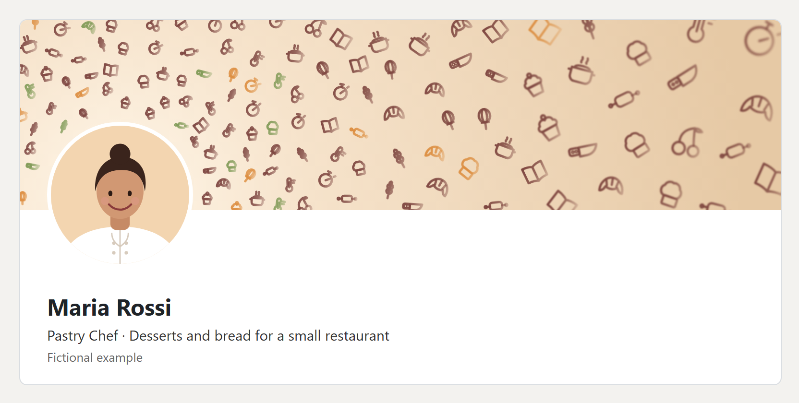
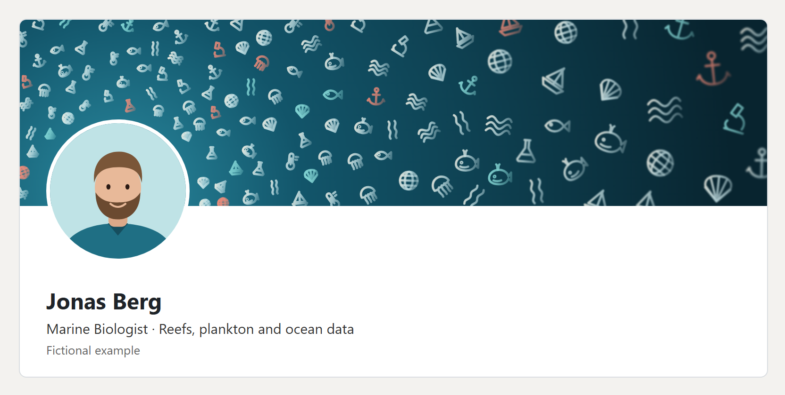
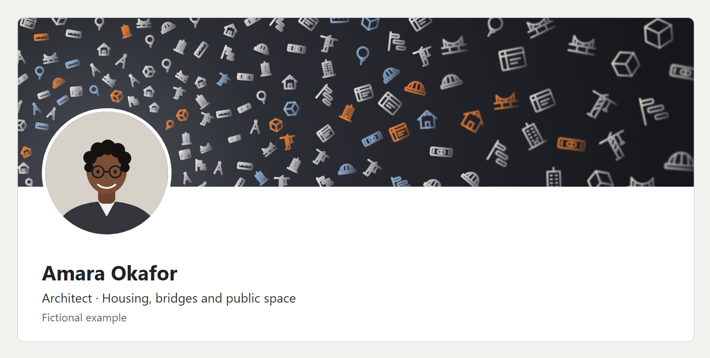

# linkedin-icon-banner

An agent skill that makes a LinkedIn banner (1584x396) from line icons. A clear space is left for the profile photo, small dense icons surround it, and they get larger, sparser and softer with distance. Every icon is lit from the left, like a typical portrait. Colours come from the photo, icons come from the person's career.

## Examples

Three fictional people, three professions, three palettes, three icon sets. The portraits are illustrations, not photos.

| | |
|---|---|
|  | **Pastry chef**: warm cream and burgundy, whisk, croissant, rolling pin, cupcake, chef hat, pot, knife, wheat, cherry |
|  | **Marine biologist**: deep teal with coral, fish, whale, jellyfish, anchor, shell, sailboat, seaweed, microscope, waves |
|  | **Architect**: graphite with signal orange, skyscraper, crane, bridge, blueprint, dividers, ruler, hard hat, tree, spirit level |

The plain banners are in `examples/*-banner.png`.

## Install

```
git clone https://github.com/bartfastiel/linkedin-icon-banner ~/.claude/skills/linkedin-icon-banner
```

Then ask your coding assistant for a LinkedIn banner. It reads `SKILL.md` and runs the generator.

## Use the generator directly

```
node scripts/banner.mjs --list
node scripts/banner.mjs --out banner.svg --theme dark --avatar 208,364,152 --icons bus,chip,cloud --weights chip=2
```

Render the SVG to PNG with headless Chrome (see `SKILL.md`). Needs Node 18+, no packages.

- `SKILL.md`: the steps, written as a skill
- `scripts/banner.mjs`: the generator
- `scripts/icons.mjs`: 82 original icons (transport, energy, embedded, cloud, engines, batteries, kitchen, sea, building and more)

## License

MIT
